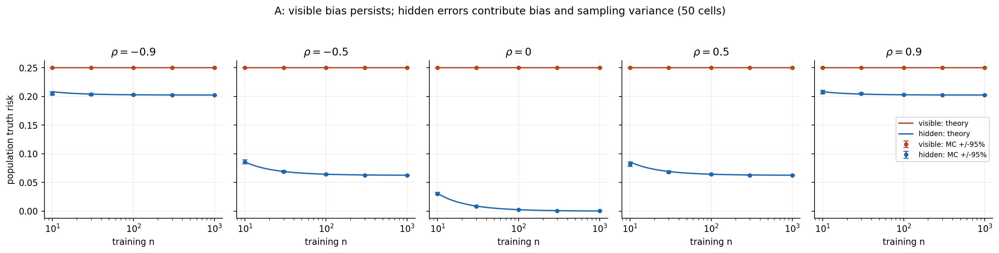

# Teacher Error Geometry Lab

교사 오류와 고정 표현에 관한 선형 이론의 CPU 재현

[English](README.md)

교사 모델의 오류를 학생이 어떻게 물려받는지 다룬 기존 선형 이론을 CPU로 독립 구현했습니다. 입력 상관과 학생이 볼 수 있는 정보 범위를 조절한 실험, 원문 Gaussian 회귀 설정 일부의 수치 재현을 통해 실제 반복 결과와 해석식을 대조했습니다.

같은 모집단 크기의 교사 오류가 학생의 실제 정답 오차에 어떻게 전달되는지 확인합니다. Gaussian 생성·교사 target·FP64 무규제 OLS·모집단 risk·paired 통계 대조·저장 기록 재현 도구를 직접 작성했습니다. NumPy/lstsq와 Matplotlib는 upstream입니다.



rho=0,n=30에서 visible 오류는 교사 일치 MSE가 약 1.5e-31이어도 실제 정답 risk가 0.25입니다. hidden 오류의 실측은 0.00846083145254395, 기대값은 0.008928571428571428입니다. P1은 84설정×각 2,000반복, 고유 dataset 62,000개에서 168,000fit입니다. P2는 20,000개 데이터를 네 방식이 공유한 80,000fit이며, 이 고정 설정에서 RM 관측 평균이 0.20767895944476805로 가장 작았습니다(기대값 0.20687515217391308). [결과와 한계](docs/RESULTS.ko.md)·[전체 자릿수 facts](data/results.json)에 연결합니다.

P1은 [Sudjianto·Burakov, arXiv:2610.26797v1](https://arxiv.org/html/2610.26797v1) §4.2의 2차원 특수형을 이용한 자체 통제 예제이고, P2는 Table 1의 n=27,lambda=.45 Gaussian 설정 부분 재현입니다. [원문 대응표](docs/claim_map.md)와 [실행 이력](docs/HISTORY.md)을 함께 읽을 수 있습니다. 원문 전체·학습되는 표현·실제 LLM·probit·CFPB 검증으로 확대하지 않습니다. AI 보조 구현·내부 점검이며 사람의 독립 심사나 원문 PyTorch 난수의 bitwise 복제를 뜻하지 않습니다.

## 설치와 저장 기록 검사

저장소 root에서 Python 3.11을 사용합니다. 설치 단계는 선언된 CPU 의존성을 내려받고, 이후 검사는 네트워크나 원 연구 경로 없이 실행됩니다. 출력은 매번 새로운 외부 경로를 지정합니다.

```bash
python3.11 -m venv .venv
.venv/bin/python -I -m pip install -r requirements-lock.txt
.venv/bin/python -I -m pip install --no-build-isolation --no-deps .
.venv/bin/python -I -m pip check
.venv/bin/python -I -B -m teacher_error_geometry verify-public --output /tmp/teg-public-NEW_ID
```

단일 명령으로 P1 17개·P2 12개·압축/도구 6개 검사를 수행하고, 증거를 복원해 최종 raw 248,000행 전체·선택 seed를 검산하며 summary와 7종 PNG/SVG를 재생성합니다. 새 receipt는 저장소 밖에 씁니다. 압축 복원만 하거나 개별 summary/그림을 만드는 명령은 [재현 안내](docs/REPRODUCTION.md)에 있습니다. [P3 보고서](docs/P3_REPORT.ko.md)는 같은 머신의 새 venv/copy 점검과 외부 독립 재현을 구분합니다. CI는 로컬 초안이며 원격 실행·게시는 미실행입니다.

## 선택적인 새 실험

저장 기록 검사와 별도인 신규 run 명령입니다. 이번 P3에서는 실행하지 않았습니다.

```bash
scripts/teg smoke --output /tmp/teg-p1-smoke-NEW_ID
scripts/teg p2 smoke --output /tmp/teg-p2-smoke-NEW_ID
scripts/teg run --config configs/p1.json --output /tmp/teg-p1-full-NEW_ID
scripts/teg p2 run --config configs/p2_paper_anchor.json --output /tmp/teg-p2-full-NEW_ID
```

wrapper는 명시적 `TEG_PYTHON`, 프로젝트 `.venv`, 현재 `python3` 순으로 선택합니다. 해당 Python에 먼저 설치해야 합니다. 자식 BLAS thread는 1입니다. [MIT](LICENSE)는 독립 작성물에 적용하며 원문 권리는 별도입니다([NOTICE](NOTICE)). 현재 상태는 로컬 공개 후보이고 원격 저장소·release의 존재를 주장하지 않습니다.
