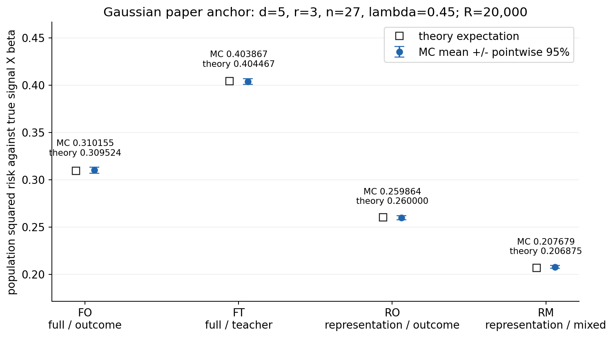
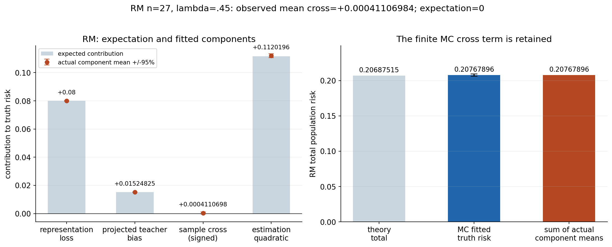

# 저장 결과

[English](RESULTS.md) · [공통 전체 자릿수 facts](../data/results.json)

P1은 84설정·각 2,000반복, 고유 dataset 62,000개에서 최종 168,000fit이며 실패/누락은 0입니다. 과거 full 두 번의 336,000 solver 호출은 같은 표본 재실행이므로 독립 4,000반복이 아닙니다. 최종 구현 검증 PASS, 통계 대조 NO_4SE_FLAGS입니다.

rho=0,n=30에서 visible truth risk는 0.25, 교사 일치 MSE는 1.4976031247555146e-31입니다. hidden truth 실측은 0.00846083145254395, 기대값은 0.008928571428571428입니다. projection-zero 오류는 입력 상관이 있어도 a=0입니다. rho=.9,n=1000의 hidden truth는 0.20255038730293556, 기대값 0.20254759519038076, 모집단 floor .2025입니다. 원문 B_A=0인 고정 표현 특수형에 대응합니다.

P2는 n=27,lambda=.45이며 각 방식 R_planned=R_rows=N_valid=20,000, N_failed=N_missing=0입니다. 고유 dataset 20,000개를 네 방식이 공유해 80,000fit을 만듭니다. 네 그룹과 여섯 paired 비교는 서로 의존합니다. FO는 full X/Y, FT는 full X/T, RO는 reduced Z/Y, RM은 reduced Z/((1-lambda)Y+lambda T)를 사용합니다.

|Method|Theory|Measured mean|MC-SE|z|
|---|---:|---:|---:|---:|
|FO|0.30952380952380953|0.31015494835202323|0.0016367640176310073|0.3856016025616098|
|FT|0.40446666666666664|0.4038669197012249|0.0015184219667590693|-0.3949804326934514|
|RO|0.26|0.2598640016423335|0.0011526614747491982|-0.11798638251193809|
|RM|0.20687515217391308|0.20767895944476805|0.0007907319008408488|1.0165357815970422|

RM은 이 단일 설정에서 관측 평균이 가장 작았습니다. 입력 정보와 target이 서로 다른 비교이므로 일반적인 증류·압축 우위로 확대하지 않습니다. 고정 lambda=.45의 값과 lambda 최적화 최소값도 구분합니다.

RM 기대 성분은 표현 손실 .08 + 투영 교사 편향 .01524825 + 기대 교차항 0 + 추정 변동 .11162690217391306입니다. MC 실제 성분은 .08000000000000004 + .015248250000000014 + .00041106984100782904 + .1120196396037602이며, 부동소수점 합산 차이 안에서 truth 평균 .20767895944476805와 같습니다. 표본 교차항의 부호를 보존했고 0으로 강제하지 않았습니다. P2는 B_A=.08의 표현 손실과 S_A+omega=.41의 잔차 결합까지 다룹니다. FT 실제 교차항 평균은 -.0005603832093237588입니다.

구간은 표본 SD(ddof=1)에 따른 pointwise mean +/-1.96 MC-SE입니다. 4SE는 조사 문턱이며 모든 95% 구간 포함·동시 보장·정리의 수치적 증명이 아닙니다. P1 일부 95% 구간은 이론값을 포함하지 않으며 최대 marginal |z|는 3.027129256419131입니다. P2의 그룹·pair·성분에 4SE flag는 없고 최대 paired |z|는 1.125915430907219입니다. 구조적 결정성은 고정 atol=1e-10,rtol=1e-9로 검사합니다. P1 관측 후 진단 수정은 [이력](HISTORY.md)에 남겼습니다.

과거 runner wall: P1 최종 9.23998189899794초, full 두 번 합계 18.40799369999877초. P2 runner 5.903453523002099초, 이를 포함한 full CLI 6.07초입니다. runner와 CLI를 합산하지 않습니다. 설치·검산·그림 재생성 비용은 별도이며 하드웨어 정규화·serving 벤치마크가 아닙니다. [P1 원 receipt](../recorded/p1/provenance/execution.json)·[P2 원 receipt](../recorded/p2/provenance/execution.json)·[P3 비용](P3_REPORT.ko.md)에서 범위를 확인합니다.

[증거 복원 안내](EVIDENCE.md)는 원 보고서와 raw 전체에 접근하는 경로를 제공합니다. 원 보고서는 byte 그대로 보존하며 과거 NOT_RUN 상태는 해당 시점의 기록입니다. P3는 LOCAL_ONLY이며 신규 과학 실험·full은 수행하지 않았습니다.
