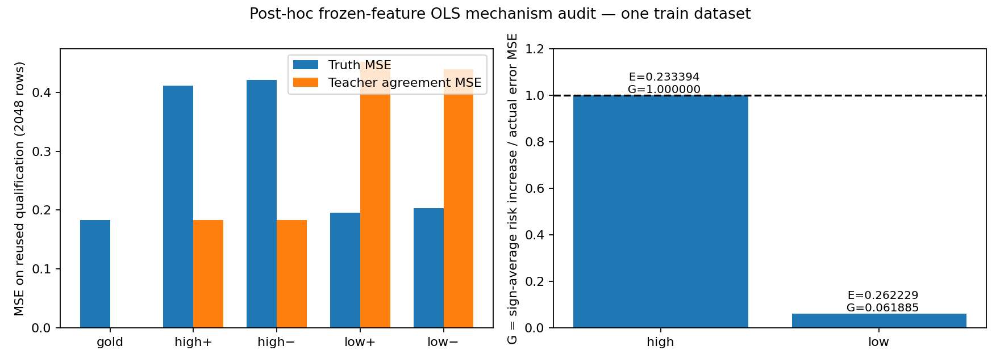

# 고정 feature 선형 부록

**고정된 선형 학생은 교사 오류를 어떻게 물려받을까요?** 실제 pretrained feature로 선형 재현 포트폴리오를 마무리한 부록입니다. 저장된 SmolLM2-135M PCA64 배열만 사용해 오염 oracle target 네 개를 FP64 OLS로 학습하고, truth risk·교사 일치·오류 전달을 독립 경로로 검산했습니다.

[English](README.md) · [프로젝트 개요](https://github.com/Munsik-Kim/teacher-error-geometry-lab/blob/main/README.ko.md) · [최종 보고서](FINAL_REPORT.ko.md)



| 오류 방향 | Truth risk R, ± 평균 | Agreement A, ± 평균 | 실제 오류 E | Risk 증가 Delta | G=Delta/E |
|---|---:|---:|---:|---:|---:|
| High | 0.416396 | 0.183002 | 0.233394 | 0.233394 | 1.0000 |
| Low | 0.199230 | 0.445555 | 0.262229 | 0.016228 | 0.0619 |

*한 train dataset과 이미 접근한 qualification 2,048행의 사후 측정입니다. 원 오류를 재정규화하지 않았습니다. Gold truth risk는 0.183002이며, 표는 반올림했습니다. 전체 자릿수와 개별 ± arm은 [facts.json](facts.json)에 있습니다.*

G는 평균 에너지의 비율입니다. High 오류는 학생의 고정 선형 span에 속하므로 G≈1은 알려진 OLS 성질의 검산입니다. Low 결과는 실제로 계산했습니다. 성공확률·모집단 투영 비중·등록 H1 판정은 아닙니다.

## 원문 재현과의 연결

P1은 [Sudjianto·Burakov, arXiv:2610.26797v1](https://arxiv.org/html/2610.26797v1) §4.2의 2차원 Gaussian 특수형을 독립 구현했고, P2는 Table 1의 d5/r3/n27/lambda.45 Gaussian 설정을 재현했습니다. [프로젝트 개요](https://github.com/Munsik-Kim/teacher-error-geometry-lab/blob/main/README.ko.md)에서 canonical 248,000행과 기존 36-test 검증을 볼 수 있습니다. 이 부록은 비Gaussian 실제 feature 위의 선형 메커니즘 점검이며, Gaussian의 유한 표본 risk 공식을 Transformer에 대입하지 않습니다.

과거 PCA16 task validation은 중단됐고, 같은 cache 진단에서 PCA64 사용 근거를 얻었습니다. 이후 독립 qualification은 오류 크기 통제에서 중단했습니다. 이 결과는 보존합니다. 이번 네 개 fit은 별도 사후 분석이며 등록 H1 main/final, H2/H3는 **NOT_RUN**입니다.

## CPU 검산과 재집계

이 디렉터리 또는 standalone 압축을 푼 root에서 Python 3.11로 실행합니다. CPU 환경 설치는 한 번이면 됩니다.

```bash
python3.11 -m venv .venv
.venv/bin/python -I -m pip install -r requirements-lock.txt
.venv/bin/python -I -m pip check
.venv/bin/python -I -B scripts/check_package.py
.venv/bin/python -I -B scripts/closeout.py verify --run results/closure_posthoc_01 --output /tmp/teg-feature-verify-NEW
.venv/bin/python -I -B scripts/closeout.py summarize --run results/closure_posthoc_01 --output /tmp/teg-feature-summary-NEW
```

`verify`는 저장 계수를 읽고 별도 QR 기준으로 prediction을 대조합니다. 기록된 검산은 53 checks PASS입니다. `summarize`는 fit0으로 표와 그림을 만듭니다. 출력은 존재하지 않는 새 외부 경로를 사용합니다. 모델·GPU·원 연구 경로·공식 데이터 생성기가 필요 없습니다. [REPRODUCTION.md](REPRODUCTION.md)에 synthetic-array tests 9개와 선택적인 네 개 fit 재실행을 설명했습니다. [원 P1/P2 저장 기록 재현](https://github.com/Munsik-Kim/teacher-error-geometry-lab/blob/v0.1.0/docs/REPRODUCTION.md)은 별도 경로입니다.

[수학·구현 대응표](CLAIM_MAP.md) · [이력·접근 범위](PROVENANCE_AND_HISTORY.md) · [전체 자릿수 facts](facts.json). 범위는 고정 선형 readout과 synthetic teacher입니다. 비선형 학생·학습되는 표현·자연 LLM 오답·생성형 증류는 검증하지 않았습니다. AI 보조 구현·내부 검산이며 과거 실패와 접근 기록은 이력에서 확인할 수 있습니다.
